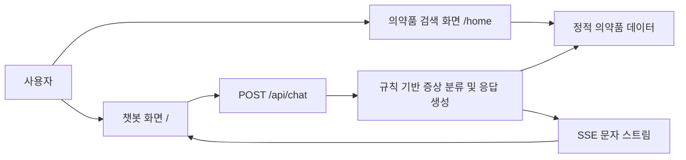

# 약장수 (Yakjangsu)

> **2025년 가을, 처음 참여한 3인 팀 해커톤에서 만든 의약품 정보 검색·증상 기반 챗봇 프로토타입**
>
> 완성된 의료 서비스보다는, **개발을 잘 모르던 시기에 AI 코딩 도구를 활용해 처음으로 웹 서비스를 만들어 본 기록**입니다.

**개발 시기:** 2025년 10월경 · **형태:** 3인 팀 해커톤 · **사용 도구:** Cursor · **프로젝트 성격:** 학습·시연용

> [!IMPORTANT]
> **실제 의료용 서비스가 아닙니다.** 의약품 데이터의 제품명·성분·효능·용법 등에 검증되지 않았거나 잘못된 정보가 있으며, 추천 로직은 의료적 안전성을 보장하지 않습니다. 복용·진단·처방 판단에 이 프로젝트를 사용하지 마세요. 이 저장소는 **2025년 당시 개발 결과물과 학습 과정을 보존하는 아카이브**입니다.

## 어떤 프로젝트인가요?

'약장수'는 사용자가 약 이름이나 증상으로 의약품 정보를 찾아보고, 채팅창에 증상을 입력하면 관련 정보를 응답하도록 만든 웹 프로토타입입니다.

2025년 첫 해커톤에 참여했을 당시 우리 팀은 세 명이었지만, 각자 어떤 일을 맡고 어떻게 협업해야 하는지도 명확하지 않았습니다. 저 역시 웹 개발과 협업에 익숙하지 않았습니다. 그 상황에서 **Cursor 유료 버전을 직접 사용하며 구현을 진행했고**, 적어도 동작하는 화면과 사용자 흐름을 만들어 보고자 했습니다.

지금 돌아보면 설계와 검증이 부족한 부분이 많습니다. 그렇지만 이 경험이 이후 개발과 팀 협업을 배우는 출발점이 되었습니다. 당시의 부족함까지 포함해 기록으로 남기려고 합니다.

## 시연 당시 구현한 것

| 기능 | 확인된 구현 내용 |
| --- | --- |
| 의약품 목록 | 코드에 정의된 의약품 항목 20개를 카드로 표시 |
| 검색·필터 | 약 이름/증상 텍스트 검색과 카테고리 선택 |
| 채팅 화면 | 사용자가 증상을 입력하고 답변을 받는 인터페이스 |
| 증상 처리 | 키워드·정규식·조건문으로 증상을 분류하는 **규칙 기반 로직** |
| 사용자 예시 | 세 가지 테스트 프로필, 간단한 로그인 UI |
| 응답 표현 | SSE 형식으로 문자 단위 응답을 순차 전송 |

**영상 기록:** 2025년 10월 말에 촬영된 로컬 시연 영상이 개인 기록으로 남아 있습니다. 영상에서는 **의약품 검색 → 카테고리 필터링 → 챗봇 대화** 화면을 확인할 수 있습니다. 원본 영상은 현재 저장소에 업로드하지 않았습니다.

## 기술 구성

- **웹:** Next.js 15 / React 19 / TypeScript
- **UI:** Tailwind CSS 4 / Radix UI 계열 컴포넌트
- **서버:** Next.js API Route (`app/api/chat/route.ts`)
- **데이터:** TypeScript 파일에 정의한 정적 의약품 목록
- **응답:** Server-Sent Events(SSE) 형식의 문자 단위 스트림
- **개발 보조 도구:** Cursor



**AI 관련 표현에 관하여:** 저장소에는 OpenAI API를 호출하는 별도 코드(`lib/ai.ts`)가 있으나, 현재 실제 채팅 엔드포인트는 그 코드를 사용하지 않습니다. 따라서 현재 동작을 **LLM 기반 의료 상담**이라고 소개하지 않습니다.

## 실행 방법

Node.js와 npm이 필요합니다.

```bash
npm install
npm run dev
```

브라우저에서 `http://localhost:3000/home`(검색) 또는 `http://localhost:3000/`(챗봇)을 엽니다.

이것은 **2025년 소스 기준 실행 안내**이며, 최근 환경에서 설치·빌드·실행 성공 여부를 별도로 검증한 것은 아닙니다. 데모를 실행하더라도 의약품 관련 답변은 의료 정보로 신뢰해서는 안 됩니다.

## 제가 이 경험에서 배운 것

당시에는 **무언가 동작하게 만드는 것**이 가장 큰 목표였습니다. 시간이 지난 뒤 코드를 다시 보니, 그다음에는 **왜 그런 구조를 선택했는지, 데이터가 정확한지, 사용자에게 어떤 위험이 있는지, 팀원이 어떻게 이어서 작업할 수 있는지**까지 책임져야 한다는 것을 알게 됐습니다.

- **잘했던 시도:** 익숙하지 않은 기술을 피하지 않고 도구를 활용해 검색·챗봇 형태를 구현해 본 것
- **부족했던 점:** 역할과 요구사항 정리, 검증 가능한 데이터, 명확한 API 경계, 기능 테스트 및 실제 AI 연동 구분
- **다시 만든다면:** 요구사항과 팀 역할부터 정하고, 검증된 정보 출처와 테스트를 마련하며, 의료 추천이 아닌 안전한 정보 탐색 범위로 기능을 제한할 것

보다 자세한 회고는 [2025년 해커톤 개발 회고](docs/retrospective-2025.md), 코드 재검토 내용은 [기술 검토 노트](docs/technical-review.md)에 정리했습니다.

## 1년 뒤의 개발 경험

2026년에는 컴퓨터공학 관련 5개 학술 동아리가 참여한 연합 해커톤에서, **EIDOS** 프로젝트의 백엔드 담당자로 참여했습니다. 그때는 AI·프론트엔드·백엔드로 역할을 나누고, API 계약·저장·작업 상태·예외 상황·테스트·협업 기록을 고려하며 개발했습니다.

2025년의 '약장수'와 2026년의 EIDOS는 기술 수준만이 아니라 **개발을 바라보는 관점이 어떻게 달라졌는지** 비교할 수 있는 두 기록입니다.

→ [2026 EIDOS 해커톤 팀 저장소](https://github.com/2026ENDPoinT/team19)

## 저장소 보존 원칙

- 당시의 **원본 애플리케이션 코드는 가능한 그대로 보존**합니다.
- 현재의 회고·기술 검토와 당시 작성한 가이드를 **서로 구분**합니다.
- 초기 README는 [archive/README_before_portfolio.md](archive/README_before_portfolio.md)에 별도로 복사했습니다.
- 2025년 작업을 사후에 과장하거나, AI 코딩 도구의 기여를 개인의 직접 구현 능력으로 부풀리지 않습니다.
- 이 프로젝트는 **3인 팀 작업**이며, 개별 코드별 작성자 및 역할 분담은 현재 자료만으로 확정할 수 없습니다.

---

*2025년에 만들었던 것을 2026년에 다시 읽고 정리한 개인 포트폴리오 기록입니다.*
