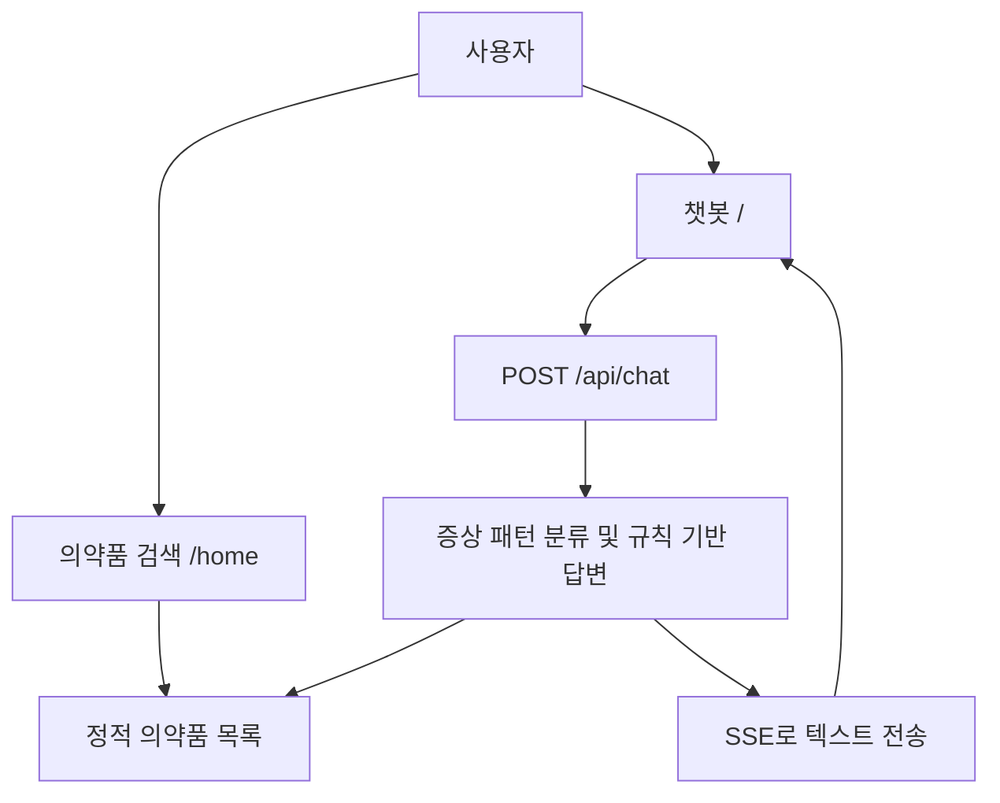

# 약장수 (Yakjangsu)

**2025년 가을 · 첫 해커톤 · 3인 팀 · Next.js / TypeScript / Cursor**

> 처음 해커톤에 참여했을 때, 우리 세 명은 각자 무엇을 맡아야 하는지조차 선명하게 정하지 못했습니다. 저는 Cursor를 유료 결제해 개발에 활용했고, 모르는 것이 많은 상태에서 일단 동작하는 웹 서비스를 만들기 위해 시도했습니다. 이 저장소는 그 **첫 개발 경험의 결과물과, 1년 뒤 되돌아본 배움**을 함께 남긴 기록입니다.

**한 줄 소개:** 약 이름·증상으로 정보를 찾아보고, 증상 입력에 정해진 규칙으로 답하는 **의약품 검색·챗봇 프로토타입**입니다. 상용 의료 서비스나 의학적으로 검증된 AI가 아닙니다.

### 🌐 웹에서 직접 체험하기

**[🔎 의약품 검색 화면 열기](https://clone-chat-gpt-cursor-mauve.vercel.app/home)** · **[💬 챗봇 화면 열기](https://clone-chat-gpt-cursor-mauve.vercel.app/)**

GitHub About에 등록된 기존 Vercel 데모 주소를 사용합니다. 소스 코드상 `/home`은 검색·카테고리 필터 화면이고 `/`는 챗봇 화면입니다. **2025년 당시의 학습용 데모이며, 약품 정보·추천을 실제 의료 판단에 사용하면 안 됩니다.** 외부 사이트 접속 가능 여부는 별도 검증이 필요합니다.


### 🎬 2025년 실제 시연 영상

**[▶ 약장수 해커톤 시연 영상 보기 (MP4 · 약 66초)](yakjangsu_demo_2025_download_v2.mp4)**

2025년 10월 28일 촬영된 로컬 실행 화면의 **압축본**입니다. 의약품 검색·카테고리 필터와 챗봇 화면을 살펴볼 수 있습니다. 원본 녹화 파일은 별도로 보관하며, 영상은 기능 시연 기록이지 의료적 정확성이나 안전성을 증명하는 자료는 아닙니다.


**2026년 재현 검증:** Node.js 22 환경에서 프로덕션 빌드·서버 실행·HTTP 검사 6/6이 통과했고, Chromium에서 검색·카테고리 필터·테스트 로그인·채팅 전송 및 응답 표시를 확인했습니다. **다만 응답 공백이 누락되는 버그가 있습니다.** → [실행·검증 기록](docs/verification-2026.md)

> [!WARNING]
> **의료용 사용 금지.** 코드에 포함된 의약품 이름·성분·효능·용법 중에는 부정확하거나 검증되지 않은 정보가 있습니다. 이 프로젝트의 추천이나 복용 안내를 실제 의료 판단에 사용하지 마세요. 이 저장소는 **2025년 당시 소스 보존 및 학습 기록용**입니다.

## 01. 왜 만들었나

2025년 10월경, 처음 참가한 해커톤에서 **'약장수'** 라는 이름으로 의약품 정보를 탐색하는 웹 서비스를 시도했습니다. 프로젝트 경험이 충분하지 않았고 팀 내 역할과 개발 흐름도 명확히 잡혀 있지 않았습니다.

그때의 제 목표는 거창한 의료 AI 구현보다 **실제로 눌러 보고 대화해 볼 수 있는 결과물을 만들어 보는 것**에 가까웠습니다. Cursor라는 AI 코딩 도구를 적극적으로 활용해 개발을 진행했으며, 이 도구의 도움을 받은 사실과 제 경험을 구분해서 기록하려고 합니다.

이 프로젝트는 **3명이 함께한 팀 결과물**입니다. 현재 자료만으로 팀원별 코드 작성량이나 정확한 분담을 재구성할 수 없어 개인 단독 개발이라고 소개하지 않습니다.

## 02. 실제로 만든 것

| 화면 / 기능 | 2025년 소스에서 확인되는 구현 |
| --- | --- |
| **의약품 검색** | 약 이름·증상으로 목록을 검색하고 카테고리 버튼으로 필터링 |
| **목록 조회** | 코드에 직접 작성한 20개 항목을 카드 형태로 표시 |
| **대화 화면** | 사용자 입력과 응답을 채팅 UI로 표시 |
| **증상 응답** | 증상 키워드·정규식·조건문을 이용해 답변을 작성 |
| **테스트 프로필** | 사용자 예시 3개, 로그인 형태의 화면, 알레르기·기저질환 등을 고려하려는 시도 |
| **스트리밍 표현** | 서버가 텍스트를 SSE 형식으로 문자 단위 전송 |

**2025년 10월 말의 약 66초 시연 영상**에서 의약품 목록, 카테고리 변경, 챗봇 화면 전환과 대화 모습을 확인했습니다. [시연 영상 압축본(MP4)](yakjangsu_demo_2025_download_v2.mp4)을 이 저장소에 공개했으며, 원본 녹화 파일은 별도로 보관합니다.

[시연 흐름과 영상 기록](docs/demo-record.md) · [구현 구조와 한계 상세](docs/technical-review.md)

## 03. 기술 구성

| 구분 | 기술 |
| --- | --- |
| 웹 화면 | Next.js 15, React 19, TypeScript |
| UI | Tailwind CSS 4, Radix UI 계열 컴포넌트 |
| API | Next.js Route Handler (`POST /api/chat`) |
| 데이터 | TypeScript 파일에 선언한 정적 의약품 목록 |
| 응답 | 서버 규칙 기반 처리 + SSE 문자 스트리밍 |
| 개발 도구 | Cursor (AI 코딩 도구) |



**'AI 챗봇'이라는 당시 이름과 실제 구현을 구별할 필요가 있습니다.** `lib/ai.ts`에는 OpenAI API 연동용 코드가 남아 있지만, **현재 의약품 챗봇의 API 경로는 해당 모델 호출 코드를 사용하지 않습니다.** 즉, 주요 응답은 LLM 추론이 아니라 규칙 기반입니다.

## 04. 당시 코드의 한계

- **정보의 신뢰성:** 의약품 데이터가 공식 자료로 검증되지 않았고, 일부 항목의 제품·성분·용법 정보에 오류 가능성이 있습니다.
- **개인화 처리:** 테스트 프로필을 브라우저에서 초기화하지만 서버는 별도의 메모리 저장소에서 조회해, 기대한 개인화가 실제로 작동하지 않을 수 있습니다.
- **인증 및 검증:** 테스트용 계정·비밀번호가 코드에 포함돼 있으며, 실제 인증 시스템이나 의료 안전성 검증을 갖추지 않았습니다.
- **응답 표시:** 문자 단위 SSE를 읽는 과정에서 공백·줄바꿈이 손실될 수 있으며, 2026년 실제 브라우저 검증에서 공백 손실을 확인했습니다.
- **검증 시점 구분:** 2025년 당시 자동화된 테스트 증거는 충분히 남아 있지 않습니다. 2026년에 새로 추가한 재현 검사는 [별도 기록](docs/verification-2026.md)으로 구분합니다.
- **의존성 보안:** 2026년 설치 로그에서 취약점 경고 12건(낮음 3, 높음 7, 심각 2)이 보고되어, 공개 서비스 운영 전 별도 점검이 필요합니다.

이러한 한계를 뒤늦게 발견한 것도 제가 성장했다는 증거라고 생각합니다. 2025년 당시의 구현과 **2026년에 추가한 기술 검토·회고**는 섞지 않고 따로 남깁니다.

## 05. 1년 뒤에 읽어 보니

2025년에는 **어떻게든 화면을 동작시키는 것**에 집중했습니다. 그 후 웹 API, 데이터 관리, 테스트, 팀 협업을 배우면서 **'실제로 동작한다'와 '올바르게 설계되고 안전하게 검증된다'는 별개의 문제**라는 점을 알게 됐습니다.

2026년에는 5개 학술 동아리가 함께한 연합 해커톤에서 [EIDOS](https://github.com/2026ENDPoinT/team19)의 **백엔드 담당**으로 참여했습니다. 그때는 AI·FE·BE 역할을 나누고, API 계약과 작업 상태, 실패 처리, 저장 및 테스트를 고려하며 협업했습니다.

| | 2025 약장수 | 2026 EIDOS |
| --- | --- | --- |
| 출발점 | 역할과 방법을 알아 가는 첫 시도 | 역할과 인터페이스를 정한 협업 |
| 제 관심 | 화면과 기본 기능의 구현 | API, 데이터, 상태, 오류와 검증 |
| AI 도구 | Cursor에 크게 의지하며 구현 | 도구를 쓰면서도 요구사항·계약·결과를 점검 |
| 남은 기록 | 코드와 짧은 로컬 시연 영상 | 역할별 문서, 코드, 테스트 및 팀 결정 기록 |

[**2025년 첫 해커톤 회고 전문**](docs/retrospective-2025.md)

## 06. 소스 확인과 로컬 실행

```bash
npm ci
npm run dev
```

- 의약품 정보 화면: `http://localhost:3000/home`
- 채팅 화면: `http://localhost:3000/`

**재현 상태:** 2026년 11월 GitHub Actions에서 `npm ci → npm run build → npm run start` 실행 및 웹/API·브라우저 기본 흐름이 확인됐습니다. `npm run dev`는 별도의 개발 모드로, 이번 검증은 프로덕션 모드를 기준으로 수행했습니다. [검증 결과 및 남아 있는 결함](docs/verification-2026.md)을 참조하세요. **실행되더라도 의료 판단에 사용해서는 안 됩니다.**

## 기록의 원칙

- 2025년 원본 소스와 커밋 이력을 가능한 그대로 보존합니다.
- 2026년에 작성한 회고, 기술 검토, 검증 기록에는 그 시점을 명확히 표시합니다.
- 팀원의 기여를 대신 주장하거나, Cursor의 기여를 감추거나, 실제로 연결되지 않은 AI 기능을 구현했다고 쓰지 않습니다.
- 최초 README는 [보존본](archive/README_before_portfolio.md)에서 볼 수 있습니다. 저장소에 남아 있는 다른 사용 설명서는 **당시 작성된 문서**입니다.

---

*2025년 10월의 첫 해커톤을, 2026년 11월에 다시 읽고 정리했습니다.*
